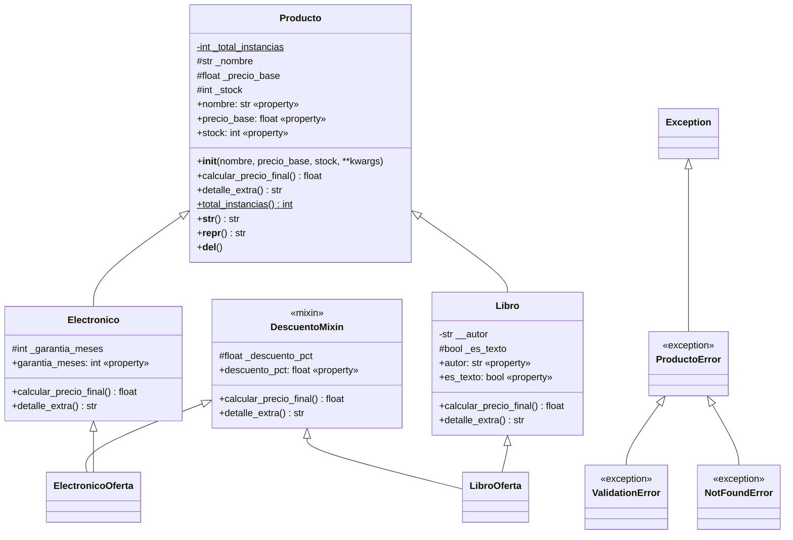

# 🛒 Sistema de Gestión de Productos (CLI) — Python POO

**Universidad Nacional del Centro del Perú** · Facultad de Ingeniería de Sistemas
**Asignatura:** Desarrollo de Aplicaciones Web (IS093A) · **Unidad II:** Desarrollo Web Fullstack
**Guía Práctica Semana 10** · **Fecha:** 04/11/2026
**Estudiante:** Jackeline Vivanco Solano · **Código:** 2022100549I
**Modalidad de trabajo:** individual (asumí los 4 roles técnicos)

Sistema por consola para registrar productos (electrónicos y libros), listarlos y
calcular su precio final. Aplica POO (herencia simple y múltiple), encapsulamiento
con `@property`, polimorfismo, excepciones personalizadas y modularización.

---

## 📁 Estructura del proyecto

```
lab10-sistema-productos/
├── main.py                  # Orquestador CLI (menú + try/except/else/finally)
├── models/
│   ├── __init__.py          # Expone las clases públicas
│   └── producto.py          # Producto, Electronico, Libro, DescuentoMixin
├── utils/
│   ├── __init__.py          # Expone validadores, formateo y excepciones
│   ├── exceptions.py        # ProductoError, ValidationError, NotFoundError
│   ├── validators.py        # Validación y sanitización de entradas
│   └── formatters.py        # Formato de moneda y títulos
├── tests/
│   ├── __init__.py
│   └── test_productos.py    # 13 pruebas: ruta feliz y ruta de error
├── capturas/                # Evidencias de ejecución
├── requirements.txt         # python>=3.11 (sin dependencias externas)
└── README.md
```

## ▶️ Cómo ejecutar

```bash
python main.py               # Ejecutar el sistema
python -m unittest -v        # Ejecutar las pruebas
python -m black .            # Formatear (PEP 8)
python -m pylint main.py models utils tests   # Análisis estático
```

Requisito: **Python 3.11 o superior** (probado en Python 3.13).

---

## 🧩 Diagrama de clases



**Leyenda:** `#` protegido (`_attr`), `-` privado (`__attr`, name-mangling), `+` público, `$` de clase.

### Reglas de negocio (polimorfismo)

| Clase | `calcular_precio_final()` |
|---|---|
| `Producto` | Lanza `NotImplementedError` (clase base abstracta) |
| `Electronico` | `precio_base × 1.18` (IGV 18 %), y **−5 %** si `stock > 50` |
| `Libro` | `precio_base`, y **−10 %** si es libro de texto (libros exonerados de IGV) |
| `DescuentoMixin` | Toma el precio de la clase siguiente en el MRO y le resta `descuento_pct` % |

Ejemplos verificados en ejecución:

| Producto | Cálculo | Precio final |
|---|---|---|
| `LibroOferta` S/ 200, texto, oferta 10 % | 200 × 0.90 × 0.90 | **S/ 162.00** |
| `ElectronicoOferta` S/ 2000, stock 12, oferta 20 % | 2000 × 1.18 × 0.80 | **S/ 1,888.00** |
| `Libro` S/ 300, general | 300 | **S/ 300.00** |
| `Electronico` S/ 2000, stock 60 | 2000 × 1.18 × 0.95 | **S/ 2,242.00** |

---

## 🔗 MRO aplicado (Method Resolution Order)

Python resuelve los métodos con **linealización C3**. Para las clases con herencia múltiple:

```python
>>> [c.__name__ for c in ElectronicoOferta.__mro__]
['ElectronicoOferta', 'DescuentoMixin', 'Electronico', 'Producto', 'object']

>>> [c.__name__ for c in LibroOferta.__mro__]
['LibroOferta', 'DescuentoMixin', 'Libro', 'Producto', 'object']
```

**Cómo funciona en este sistema:**

1. Al llamar `oferta.calcular_precio_final()`, Python busca primero en `DescuentoMixin`
   porque está **a la izquierda** en `class ElectronicoOferta(DescuentoMixin, Electronico)`.
2. El Mixin ejecuta `super().calcular_precio_final()`. Ese `super()` **no** va a la clase
   padre del Mixin (`object`), sino a la **siguiente clase del MRO del objeto**: `Electronico`.
3. `Electronico` calcula el precio con IGV y se lo devuelve al Mixin, que aplica la oferta.

Lo mismo ocurre con los constructores: todos los `__init__` son **cooperativos**
(reciben `**kwargs` y llaman a `super().__init__(**kwargs)`), así cada clase toma los
argumentos que le corresponden y pasa el resto a la siguiente de la cadena:

```
ElectronicoOferta(...)
 └─ DescuentoMixin.__init__   → toma descuento_pct
     └─ Electronico.__init__  → toma garantia_meses
         └─ Producto.__init__ → toma nombre, precio_base, stock
             └─ object.__init__
```

Se evita el "problema del diamante" porque el Mixin **no hereda de `Producto`**:
solo aporta comportamiento y depende del MRO para encadenarse.

### ¿Por qué herencia y no composición?

| Criterio | Decisión |
|---|---|
| `Electronico` y `Libro` **son** productos (relación *es-un*) | **Herencia**: comparten atributos, validaciones y `__str__`, y cada uno sobrescribe `calcular_precio_final()`. Así el inventario trata a todos por igual (polimorfismo). |
| El descuento promocional es un comportamiento **transversal** que puede aplicarse a cualquier tipo | **Mixin (herencia múltiple)**, como pide la guía, para demostrar MRO y `super()` cooperativo. |
| Alternativa considerada | **Composición** (`Producto` con un objeto `Descuento` dentro) sería preferible si un producto pudiera tener varias promociones combinables o cambiarlas en tiempo de ejecución. Para este alcance, el Mixin es más simple y cumple el requisito. |

---

## 🛡️ Encapsulamiento y validación

- Atributos **protegidos** (`_nombre`, `_precio_base`, `_stock`, `_garantia_meses`, `_es_texto`)
  y uno **privado** con name-mangling (`__autor` → `_Libro__autor`).
- Todo acceso pasa por `@property`; los **setters validan rangos** y lanzan `ValidationError`:
  - nombre: 2 a 60 caracteres · precio: 0.01 a 100 000 · stock: 0 a 10 000
  - garantía: 0 a 60 meses · autor: mínimo 3 letras y sin números · descuento: 0 a 50 %
- Sanitización de entrada en `utils/validators.py`: elimina espacios sobrantes, convierte
  tipos y normaliza la categoría (`" Libro "` → `"libro"`).

## ⚠️ Manejo de excepciones

Jerarquía propia: `Exception → ProductoError → ValidationError / NotFoundError`.

En el bucle principal de `main.py`:

| Bloque | Función |
|---|---|
| `try` | Ejecuta la opción elegida |
| `except ValidationError` | Dato inválido → mensaje ⚠️ y registro en `app.log` |
| `except NotFoundError` | ID inexistente → mensaje 🔍 y registro en `app.log` |
| `except (KeyboardInterrupt, EOFError)` | Ctrl+C → cierre limpio |
| `except Exception` | Error imprevisto → **se registra con traceback** (nunca se silencia) |
| `else` | Registra que la operación terminó sin errores |
| `finally` | Cuenta y registra **cada** operación, haya error o no |

---

## 🖼️ Capturas de ejecución

### Caso exitoso


### Excepción 1: `ValidationError`


### Excepción 2: `NotFoundError`


### Calidad: pruebas, Black y Pylint


---

## ✅ Control de calidad (rol QA)

- **13 pruebas** con `unittest` (`tests/test_productos.py`): 6 de ruta feliz
  (cálculos, MRO, polimorfismo, validadores) y 7 de ruta de error (rangos inválidos,
  formato numérico, categoría, ID inexistente, setter que protege el estado).
- **Black**: código formateado según PEP 8.
- **Pylint**: **10.00/10**.

## 📝 Mejoras respecto al código base

1. `from typing import override` solo existe desde Python 3.12; se añadió un respaldo
   para que funcione con `python>=3.11`, como indica `requirements.txt`.
2. `Libro` recibe `es_texto` para poder aplicar el descuento de "libro de texto".
3. `validar_numero` ahora también captura `TypeError` y encadena la excepción original (`from exc`).
4. `except Exception` ya no se silencia: se registra en `app.log` con traceback, como
   recomiendan las notas técnicas.
5. Se agregó el bloque `else` y se dio uso real al `finally`.
6. `__del__` solo informa; no contiene lógica crítica porque no es determinista.

## 👩‍💻 Roles técnicos (trabajo individual)

| Rol | Entregables |
|---|---|
| Arquitecta POO | Diagrama de clases, jerarquía, MRO, `super()` cooperativo, `__init__`/`__del__` |
| Desarrolladora de lógica | Menú CLI, funciones imperativas, diccionario `{id: producto}` |
| Ingeniera de excepciones y validación | Excepciones custom, `@property`, sanitización |
| QA y documentadora | Pruebas, Black, Pylint 10/10, este README |
